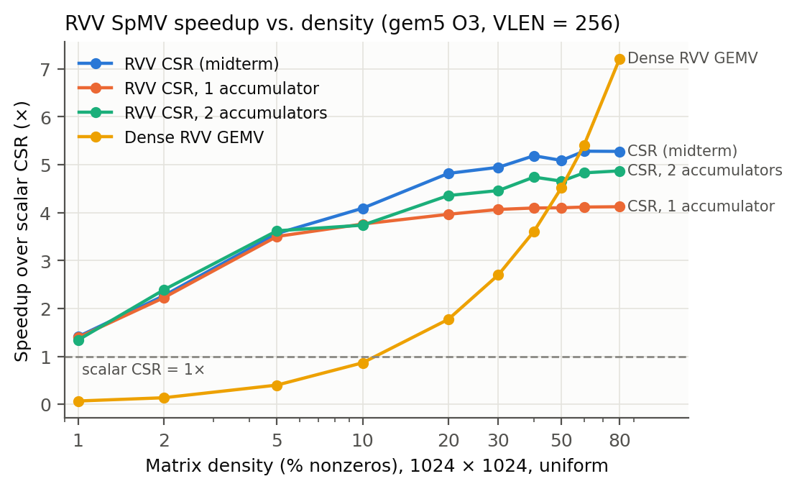
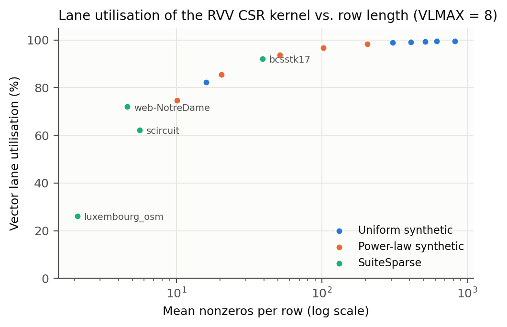
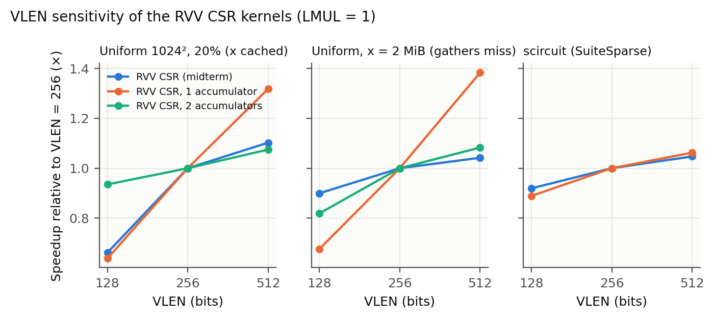
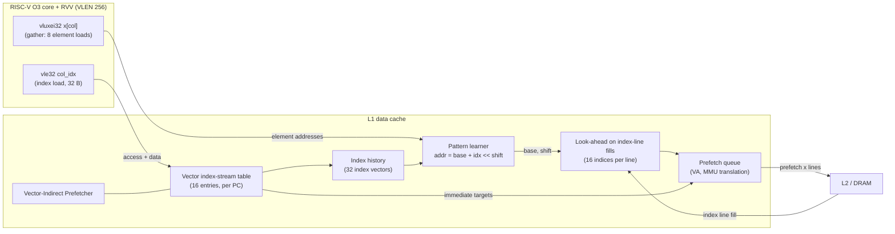
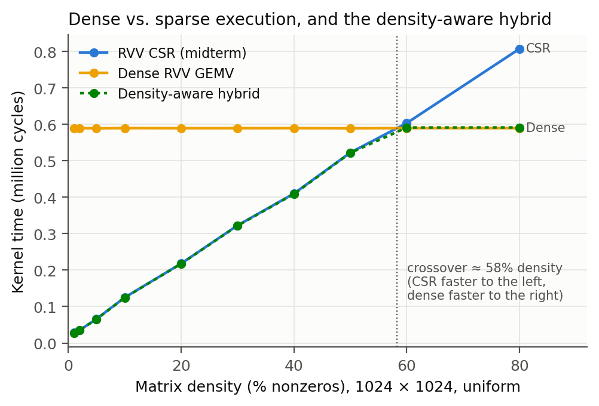
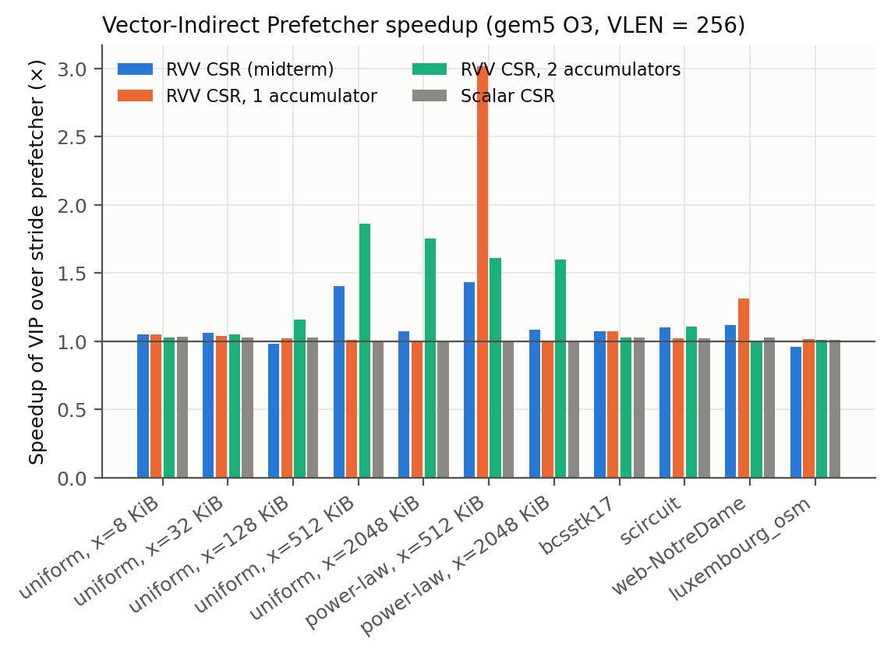
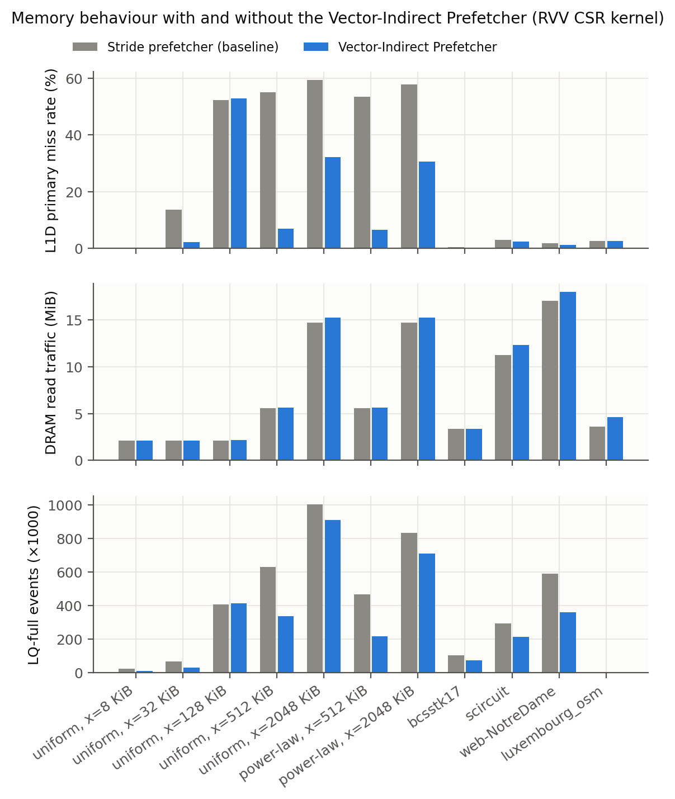
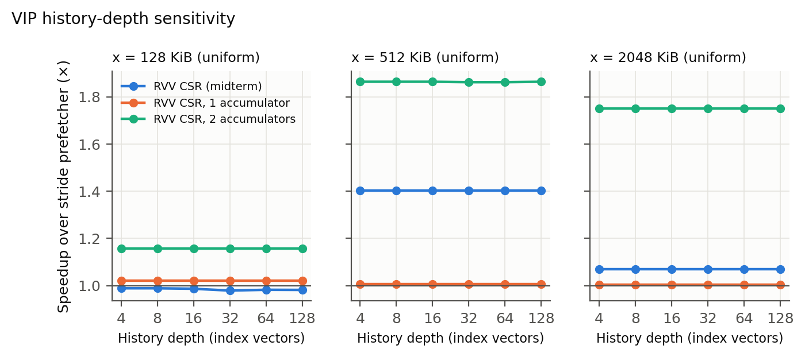

# Sparse-Aware RISC-V Vector Architecture: Final Report

**Course project, Computer Architecture.** All results come from gem5 simulation; every number below is read from a simulation output or computed from one by a script in `scripts/`. Sources are given per section; raw per-run data is in `results/endterm/phase5/all_runs_metrics.csv`.

## Abstract

Sparse matrix–vector multiplication (SpMV) is limited on vector processors by *gathers*: indexed loads of `x[col[k]]` at irregular addresses. We characterise the RISC-V Vector Extension (RVV 1.0) on SpMV with a cycle-level gem5 model of an out-of-order RISC-V core with 256-bit vectors, then propose and evaluate sparse-aware mechanisms in software and in hardware.

- **Characterisation.** After correcting the measurement methodology (94–97% of the originally reported time was not the kernel), RVV CSR SpMV is 1.4–5.3× faster than scalar CSR and dense execution wins above ≈58% density. Once the gathered vector misses in cache, up to 73% of kernel time is gather stalls, and wider vectors help little (9–11% from VLEN 128 → 256).
- **Software.** Zero-skipping on dense data does not pay off because the zeros still have to be loaded. A density-aware hybrid that picks dense or CSR execution per row block is 1.15–1.60× faster than the best single format on mixed-density matrices.
- **Hardware.** A new gem5 prefetcher, the Vector-Indirect Prefetcher (VIP), learns the index-to-address relation of RVV gathers despite out-of-order execution and prefetches gather targets ahead of use from incoming index cache lines. It speeds up SpMV by up to 1.43× over gem5's stride prefetcher (1.6–1.9× for a two-accumulator kernel), reduces L1D misses from 55% to 7%, and gives 1.08–1.35× on real circuit and web-graph matrices, with an estimated ≈ 2 KiB of state (a 4-entry index history suffices).
- **Simulator.** Four gem5 25.1 bugs were found and isolated with standalone reproducers.

## 1. Motivation

SpMV (`y = A·x`, A sparse) dominates iterative solvers, graph analytics and sparse ML inference. CSR SpMV vectorises naturally: load a chunk of nonzero values and their column indices, gather `x` at those indices, multiply, accumulate. Unlike dense kernels, its performance depends on:
1. how many vector lanes a row can fill (row length vs. vector length);
2. whether the gathered `x[col[k]]` hit in cache.

RVV's vector-length-agnostic design addresses (1) only partly, and nothing in the base ISA addresses (2). This project asks:
- How does RVV SpMV behave across densities, sizes and real matrices?
- Where does the time go?
- What sparse-aware support, in software or hardware, recovers it?

## 2. Background

- **RVV 1.0.** 32 vector registers of VLEN bits; element width SEW; register grouping LMUL; active length `vl` set by `vsetvli`; tail and mask policies (agnostic/undisturbed); unit-stride, strided and indexed (gather/scatter) memory operations; reductions (`vfredusum`); compress (`vcompress`) and masks.
- **CSR:** `values[]`, `col_idx[]`, `row_ptr[]`. Dense storage beats CSR in footprint above 50% density for 32-bit values and indices.
- **Prefetching irregular accesses.** Stride prefetchers cannot predict `x[col[k]]`. The Indirect Memory Prefetcher (IMP; Yu et al., MICRO 2015) learns `addr = base + (index << shift)` from scalar index loads. gem5 ships an IMP implementation, but it reads indices only from loads of ≤ 8 bytes, assumes one index per access, and in gem5 25.1 panics on read hits (§8). An open upstream gem5 PR (#3514) is reconstructing IMP independently; it does not target vector index loads.

Literature review: `docs/rvv_sparse_architecture_review.md`.

## 3. Methodology

**Simulated machine** (gem5 v25.1.0.1, SE mode; identical to the midterm machine):
- RISC-V out-of-order core (`RiscvO3CPU`) at 1 GHz, 8-wide, 192-entry ROB, 32-entry load queue;
- RVV with VLEN = 256 (128 and 512 swept), ELEN = 64;
- private 32 KiB L1I/L1D and 512 KiB L2 with stride prefetchers;
- DDR3-1600.

Config: `configs/sparse_rvv.py`.

**Measurement.**
- Only the kernel is timed: gem5 m5ops at the ROI boundaries (`src/common/roi.h`) give separate stats dumps for setup, kernel and validation.
- A no-op-call control showed that the markers do not perturb timing.
- Kernels are compiled with 64-byte function/loop alignment. Without it, the *unchanged* kernel's time moved 4.7% between builds; with it, layout shifts change kernel cycles by < 0.1%.
- Each run does one untimed warm-up execution of the same kernel, then one timed one.
- Comparisons always use the same binary and **byte-identical program arguments**. Even an unused extra argument shifts the initial stack and changed cycles by up to 0.12%.

**Correctness.**
- Every run validates its output against a double-precision scalar reference built without vector instructions (relative error ≤ 1e-4 of Σ|a·x| per output).
- All kernels also pass a QEMU functional test suite (`make qemu-test`).
- The program prints exact work counts (vector chunks, lanes, useful lanes), which match gem5's committed micro-op counts.

**Workloads** (`src/harness/matrix.c`):
- the midterm pattern;
- fixed-seed uniform and power-law (Pareto α = 1.8) row-length generators, O(NNZ);
- mixed-density row bands;
- four SuiteSparse matrices: bcsstk17 (FEM), scircuit (circuit), web-NotreDame (web graph), luxembourg_osm (road network);
- SpMM with K = 4–16 dense columns as a second workload.

**Kernels** (`src/kernels/`, RVV C intrinsics):
- scalar CSR;
- `rvv_orig` (midterm: per-chunk reduction);
- `rvv_opt` (single vector accumulator, one reduction per row);
- `rvv_acc2` (two accumulators);
- dense RVV GEMV;
- SpMM (vectorised over K, and column-wise gather);
- mask-skip and compaction dense kernels;
- the density-aware hybrid.

LMUL ≥ 2 *gather* kernels are excluded from all claims (gem5 bug, §8).

In total: **807+ gem5 simulations**, about 2,000 lines of C, about 2,000 lines of Python/shell, and 534 lines of new gem5 C++.

## 4. Baseline characterisation



- **The measurement matters.** The midterm timed the whole program. Kernel-only measurement shows the kernel is 3.2–6.5% of it, and that tripling the nonzeros costs the kernel 2.44× time rather than the 1.31× suggested before (`results/endterm/phase1/`).
- **RVV vs. scalar:** 1.41× at 1% density (about 10 nonzeros/row) up to 5.28× at 60–80% (1024², uniform). The gain follows lane utilisation: 74% at 10 nonzeros/row, above 99% at ≥ 300.
- **Short rows hurt.** On luxembourg_osm (2.1 nonzeros/row, 26% lane utilisation) RVV is *slower* than scalar (0.92×). On SuiteSparse overall: bcsstk17 3.01×, web-NotreDame 1.67×, scircuit 1.22×.
- **Gathers that miss dominate.** Growing `x` from 8 KiB to 2 MiB (same 16 nonzeros/row) raises the kernel's L1D primary miss rate from 0.1% to 59% and the L2 miss rate to 70%, and multiplies load-queue-full stalls 46×. 72.9% of the 2 MiB kernel time is attributable to `x` misses.
- **VLEN helps when cached, not when missing.** VLEN 128 → 256 gives 1.47–1.51× when `x` is cached, but only 1.09–1.11× when gathers miss.
- **A textbook optimisation backfires.** The single-accumulator kernel (one reduction per row) is 2.73× *slower* than the per-chunk-reduction kernel when gathers miss: its loop-carried `vfmacc` chain serialises the misses. Two accumulators recover part (2.13×).
- **SpMM:** vectorising over the dense dimension (unit-stride, no gathers) gives 2.8–25.1× over scalar and always beats the gather-based variant.




## 5. Proposed sparse-aware architecture



### 5.1 Software: density-aware execution (Phase 4A)

| Mechanism | Idea | Result (1024², uniform and mixed) |
|---|---|---|
| Mask skipping (`dense_skip`) | Dense input; `vmfne` mask + `vcpop`; all-zero chunks skip load and FMA; masked FMA otherwise | Never faster than plain dense (0.45–1.00×), although it skips up to 92% of chunks: the zeros must still be loaded |
| Compaction (`dense_compress`) | `vcompress` packs nonzeros and their indices into full vectors | 100% useful arithmetic lanes but 1.3–6.3× slower than dense, 5.9–36× slower than CSR |
| **Density-aware hybrid** | Per 64-row block: dense GEMV if block density ≥ threshold, CSR otherwise; threshold = measured crossover (58.2%) | Matches the better format on uniform matrices (1.00–1.01×); **1.15–1.60× faster than the best single format on mixed-density matrices**; robust to the threshold (40% vs. 58.2%: < 0.5%) |



**Crossover analysis.**
- At 1024 columns the dense RVV GEMV costs about 0.59M cycles regardless of density, while CSR time grows linearly with the nonzeros.
- The CSR/dense time ratio crosses 1 between 50% (0.889) and 60% (1.024) density; linear interpolation gives ≈58%.
- Above that, storing the zeros is cheaper than indexing the nonzeros, so the hybrid's per-block choice is worthwhile exactly when a matrix mixes regions on both sides of this line.

### 5.2 Hardware: the Vector-Indirect Prefetcher (Phase 4B)

`VectorIndirectPrefetcher` (gem5 `SimObject`, `src/mem/cache/prefetch/vector_indirect.{hh,cc}`; patch `gem5_patches/sparse_aware.patch`) extends gem5's stride prefetcher on the L1D:

1. **Vector index-stream table:** per load PC, it tracks sequential read streams of ≥ 8 bytes in multiples of 4 bytes, i.e. RVV unit-stride loads of 32-bit indices. On hits it reads all indices of the access directly from the packet; gem5's `PrefetchInfo` carries no data for hits (§8).
2. **Out-of-order-tolerant learning.** Out-of-order execution runs later index loads ahead of earlier gathers, so a gather access is matched against a history of the last 32 index vectors. Candidates `(base, shift)` from several gather accesses of the same PC are intersected until one remains; sampled checks keep it alive.
3. **Look-ahead prefetching:** when an index line *fills* the cache ahead of use (brought in by the inherited stride logic), its 16 indices are read and their target lines prefetched. Immediate prefetching from the index load itself arrives too late to matter.
4. **Virtual addresses + MMU translation:** gather targets are on different pages than the index access.
5. **12 statistics counters** (`*.prefetcher.vip.*`).

Implementation required four measurement-driven corrections to the initial design (`docs/phase4b_design.md` §6). The patched gem5 reproduces the original binary's results exactly when VIP is not selected.

## 6. Results



**Speedup over gem5's stride prefetcher** (184 runs, all validated). "Indirect-only" compares against the same prefetcher with its indirect part off, isolating the new mechanism from the virtual-address stride mode (worth up to 1.07× on its own).

| Input | RVV CSR (`rvv_orig`): total / indirect-only | 1-accumulator | 2-accumulator | scalar |
|---|---:|---:|---:|---:|
| uniform, `x` = 512 KiB (misses L1, hits L2) | **1.40× / 1.39×** | 1.01× | **1.86×** | 1.01× |
| power-law, `x` = 512 KiB | **1.43× / 1.42×** | **3.02×** | 1.61× | 1.01× |
| `x` = 2 MiB (DRAM), uniform / power-law | 1.07× / 1.06×; 1.08× / 1.08× | 1.00× | 1.75×; 1.60× | 1.00× |
| web-NotreDame (web graph) | 1.12× / 1.08× | 1.31× | 1.00× | 1.02× |
| scircuit (circuit); at VLEN 512 | 1.10× / 1.08×; **1.35×** | 1.02× | 1.10× | 1.02× |
| inputs whose gathers already hit (`x` ≤ 32 KiB, bcsstk17, 1024² at 5%/20%) | 1.01–1.07× / 0.99–1.01× | 1.01–1.09× | 1.00–1.06× | 1.00–1.03× |
| luxembourg_osm; `x` = 128 KiB (uniform, power-law) | 0.96× / 0.94×; 0.98× / 0.97–0.98× | 1.01×; 1.02–1.43× | 1.01×; 0.82–1.16× | 1.01–1.03× |



**Why it helps** (`rvv_orig`, uniform, `x` = 512 KiB):
- L1D primary miss rate 55.0% → 6.8%;
- L1D prefetch coverage 12% → 86%, accuracy 24% → 63%;
- load-queue-full stalls −47%.

Ablations: without look-ahead the indirect part gives at most 1.06×. The look-ahead window hardly matters (256 B / 1 KiB / 4 KiB: 1.37 / 1.40 / 1.40×).

**Where it does not help.**
- **DRAM-resident `x`:** coverage falls to 27% and the L2 miss rate stays at 71%; prefetches arrive late.
- **Missed learning:** the single-accumulator kernel on uniform rows never learns the pattern (0 targets issued).
- **Already-hitting inputs:** useless prefetches pollute the L2 (luxembourg_osm: L2 miss rate 26.5% → 36.5%, 0.96×).

The follow-up studies on history depth and L1D MSHRs are reported in §6.1.

### 6.1 Follow-up: history depth and MSHRs (70 runs, all validated)



**History depth** (4 to 128 index vectors; uniform `x` = 128 KiB / 512 KiB / 2 MiB × three kernels):
- **The speedup is the same at every depth** in all 9 configurations: e.g. 1.40× at 512 KiB for the RVV CSR kernel and 1.86× for the two-accumulator kernel at depths 4 to 128.
- The depth-32 runs reproduce the main evaluation cycle for cycle.
- **A 4-entry history is enough for these inputs.** Out-of-order lag between index loads and gathers did not exceed it.
- The single-accumulator kernel issues no targets at **any** depth on these inputs. Its failure to learn is therefore *not* caused by the history window, and the cause remains open.

**L1D MSHRs** (16 default, 32, 64):

| Input | Kernel | 16 | 32 | 64 |
|---|---|---:|---:|---:|
| uniform, 512 KiB | RVV CSR | 1.40× | 1.43× | 1.43× |
| uniform, 512 KiB | 2-accumulator | 1.86× | 1.86× | 1.87× |
| uniform, 2 MiB | RVV CSR | 1.07× | 1.01× | 1.01× |
| uniform, 2 MiB | 2-accumulator | 1.75× | 1.95× | 1.96× |

- More MSHRs help VIP on the two-accumulator kernel at 2 MiB, but not on the RVV CSR kernel. There the VIP run itself becomes slower (1,947,754 → 2,069,207 cycles).
- The hypothesis that the 2 MiB case is MSHR-limited is therefore **supported only for the two-accumulator kernel**. The midterm kernel's small DRAM-regime gain has another cause, likely prefetch timeliness against DRAM latency, which is not yet isolated.

## 7. Hardware overhead

Analytic storage estimate, `scripts/vip_storage.py`. Bit widths are stated in the script: Sv39 virtual addresses, 44-bit physical addresses, 64-byte lines, 32-bit indices.

| History depth | As simulated (history per stream entry) | Shared organisation (2 history buffers) |
|---:|---:|---:|
| **4 (sufficient, §6.1)** | **5.7 KiB** | **2.1 KiB** |
| 8 | 10.3 KiB | 3.3 KiB |
| 16 | 19.7 KiB | 5.5 KiB |
| 32 (main evaluation) | 38.3 KiB | 10.1 KiB |

- The index history and the learning-time candidate buffer dominate. The streaming part (stream table + dedup filter + pending queue) is about 1.0 KiB.
- **The history-depth study (§6.1) shows depth 4 gives the same speedups as depth 32** on the 9 tested configurations. With 2 shared history buffers that puts VIP at **≈ 2.1 KiB of state**, about 7% of the 32 KiB L1D it serves; ≈ 5.7 KiB with a history per stream entry.
- Caveat: the small depth was tested on the uniform size sweep only; power-law and SuiteSparse inputs were evaluated at depth 32.
- No RTL synthesis was done.

## 8. Simulator issues found (`docs/gem5_rvv_issues.md`)

| # | gem5 25.1.0.1 bug | Impact on this project |
|---|---|---|
| 1 | O3: `vfredusum.vs` at LMUL ≥ 2 reads stale `vs2` registers when `vd` overlaps `vs2` after a tail-undisturbed write | Reductions fold to LMUL=1 first |
| 2 | O3: LMUL > 1 indexed gathers intermittently return wrong data when many element micro-ops are in flight | LMUL ≥ 2 gather kernels excluded (25 failed runs, 0 failures among 246 LMUL=1 runs) |
| 3 | O3: a tail-undisturbed `vslideup`/`vslidedown` buffer read at full width gives stale data (page-table fault) | Compaction stages through memory |
| 4 | `IndirectMemoryPrefetcher` panics on every read hit (`PrefetchInfo` has no data because hits are notified before the packet becomes a response) | VIP reads the packet directly; IMP cannot be a baseline |

Issues 1–3 are correct on gem5's in-order MinorCPU and on QEMU. Issue 4 also fails on MinorCPU. All four were reproduced on the unmodified gem5 binary with standalone reproducers (`docs/gem5_bug_reports/`, ready to file; duplicate check done).

## 9. Limitations

- **Simulation only** (gem5 SE mode); no hardware measurements. The O3 model's RVV support has the bugs listed above.
- **LMUL ≥ 2 gathers** could not be evaluated reliably (gem5 Issue 2); the LMUL study covers only dense kernels.
- **Moderate input sizes:** inputs are bounded by simulation time (largest: 1.5M nonzeros, about 10 minutes per run). Only 4 SuiteSparse matrices.
- **VIP is not throttled** and loses up to 18% in one configuration. Its learning fails for the single-accumulator kernel on uniform rows, for a reason not yet identified (not the history depth). The small-history (≈ 2 KiB) result is shown on the uniform sweep only.
- **The storage estimate is analytic,** not synthesised.
- **Timing sensitivity:** small effects (≤ 0.12%) from program-argument layout; all comparisons use identical arguments.

## 10. Future work

- **Accuracy-based throttling** for VIP; prefetching into the L2 when `x` exceeds the L1; MSHR-aware issue.
- **Root-cause the missed learning** of the single-accumulator kernel; a cheaper learning scheme than candidate intersection; synthesis of the VIP tables.
- **Gather coalescing** in the LSQ (micro-ops of one `vluxei` hitting the same line), building on gem5 discussion #3278, once the LMUL>1 gather bug is fixed.
- **Format/kernel auto-selection** (hybrid) driven by run-time row statistics rather than a fixed threshold; combining the hybrid with VIP.
- **Upstreaming:** the four gem5 bug reports, a fix for Issue 4, and VIP as a contribution related to PR #3514.

## 11. Reproducibility

`README.md` → "Reproducing". In short:

```bash
docker build -t sparse-rvv-env docker/
scripts/env.sh 'BUILD=1 scripts/apply_gem5_patch.sh /workspace/gem5'
scripts/env.sh scripts/run_all.sh
```

Exact tool versions are listed in the README.

## References

1. RISC-V International, *The RISC-V Instruction Set Manual: "V" Standard Extension for Vector Operations*, v1.0.
2. RISC-V Vector C Intrinsics Task Group, *RISC-V Vector C Intrinsic Specification*, v1.0.
3. N. Binkert et al., "The gem5 simulator," *SIGARCH Computer Architecture News* 39(2), 2011; J. Lowe-Power et al., "The gem5 simulator: Version 20.0+," arXiv:2007.03152, 2020.
4. X. Yu, C. J. Hughes, N. Satish, S. Devadas, "IMP: Indirect Memory Prefetcher," *MICRO-48*, 2015.
5. T. A. Davis and Y. Hu, "The University of Florida Sparse Matrix Collection," *ACM TOMS* 38(1), 2011.
6. gem5 GitHub issue #3278 (sparse-address memory instructions in O3) and pull request #3514 (IndirectMemoryPrefetcher reconstruction).
7. Literature cited in `docs/rvv_sparse_architecture_review.md`.
